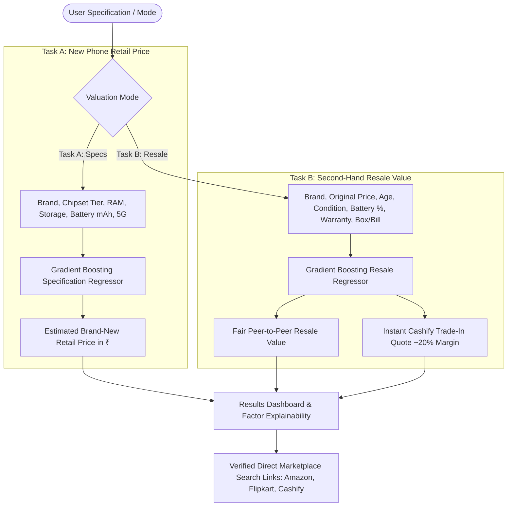

# Phonelytics — AI-Powered Smartphone Price Prediction & Resale Intelligence

> **Tagline:** Know the worth. Make the move.  
> **Category:** Multi-Task Smartphone Valuation & Secondary Market Intelligence  
> **Target Market:** India (₹ INR)  
> **Academic Context:** AI Applications Practical & Capstone Project  
> **License:** MIT License  

---

## 1. Executive Summary & Purpose

In the Indian smartphone market, price opacity creates severe friction for consumers:
- **Resellers** struggle with protracted peer-to-peer negotiations or accept heavy operator markdowns on instant trade-in sites without understanding fair market value.
- **Buyers** lack clear benchmarks to evaluate whether an asking price reflects genuine hardware depreciation or cosmetic neglect.
- **Retail shoppers** often compare older flagship models with entry-level new phones without understanding how silicon specifications dictate initial pricing.

**Phonelytics** provides a transparent, dual-model machine learning architecture that separates **Task A: Brand-New Retail Price Estimation** from **Task B: Second-Hand Resale Valuation**.

---

## 2. Research-Informed Engineering Synthesis

Phonelytics synthesizes verified lessons from four public Indian smartphone engineering repositories (documented in full in [`docs/REFERENCE_RESEARCH.md`](docs/REFERENCE_RESEARCH.md)):

| Reference Repository | Domain Focus | Key Lesson Adopted in Phonelytics |
| :--- | :--- | :--- |
| **`Ikdoumi-Ilian/india-smartphone-price-prediction`** | Indian market EDA & pricing | Imputed conditional medians instead of dropping incomplete rows (preventing selection bias against flagship iPhones); grouped sparse brands into an "Other" category; transparent disclosure of dataset age (~2023). |
| **`Prabhkirat-Singh-Marwah/used-phone-price-predictor`** | Used phone resale modeling | Engineered resale-specific features (`age_months`, `condition`, `battery_health`, `warranty_months`, `has_box_bill`); modeled steep battery replacement penalties (&lt;80%); transparently disclosed synthetic noise calibration. |
| **`CHIRAGKUMAR1718/mobile-price-predictor`** | Model-to-web integration | Built an atomic scikit-learn `Pipeline` with `OneHotEncoder` and `StandardScaler` serialized via `joblib`; dynamic catalogue-driven dropdown inputs. |
| **`bipinwaghmare/smartphone-price-prediction-streamlit-flipkart-data`** | E-commerce specs & Gradient Boosting | Utilized Gradient Boosting regression for spec-driven retail pricing (`ram_gb`, `storage_gb`, `battery_mah`, `processor_tier`, `is_5g`); enforced clear boundaries between model estimates and live marketplace search links. |

---

## 3. The Two Separate Valuation Tasks

To preserve scientific rigor, Phonelytics does **not** conflate new-product pricing with secondary depreciation:



### Task A — Brand-New Smartphone Retail Estimation
- **Target:** `retail_price_inr`
- **Features:** `brand`, `processor_tier` (Flagship, Upper-Midrange, Midrange, Budget), `ram_gb`, `storage_gb`, `battery_mah`, `is_5g`.
- **Purpose:** Estimates store shelf price based strictly on silicon hardware, battery scale, and manufacturer brand equity.

### Task B — Second-Hand Resale Valuation
- **Target:** `second_hand_price` (peer-to-peer OLX fair value) and `resale_tradein_quote` (instant Cashify buyback).
- **Features:** `brand`, `model`, `ram_gb`, `storage_gb`, `age_months`, `condition` (Like New, Excellent, Good, Fair, Poor), `battery_health`, `warranty_months`, `has_box_bill`, `original_price`.
- **Purpose:** Models non-linear electronic depreciation, cosmetic degradation, battery threshold penalties, and secondary market liquidity.

---

## 4. Model Benchmarks & Evaluation

Both models were trained using scikit-learn on an 80/20 train/test holdout split ($N=1,600$ observations each, `seed=42`):

### Task A: New Smartphone Retail Model Benchmark
| Model | MAE (₹) | RMSE (₹) | $R^2$ Score | Median Abs. % Error (MdAPE) |
| :--- | :---: | :---: | :---: | :---: |
| **Gradient Boosting Regressor** | **₹2,748.89** | **₹5,124.44** | **0.9819** | **3.30%** |
| Random Forest Regressor | ₹3,682.97 | ₹6,334.40 | 0.9723 | 4.39% |
| Ridge Regression (Baseline) | ₹10,079.98 | ₹14,118.17 | 0.8622 | 16.16% |

### Task B: Second-Hand Resale Model Benchmark
| Model | MAE (₹) | RMSE (₹) | $R^2$ Score | Median Abs. % Error (MdAPE) |
| :--- | :---: | :---: | :---: | :---: |
| **Gradient Boosting Regressor** | **₹2,099.10** | **₹3,155.38** | **0.9887** | **4.94%** |
| Random Forest Regressor | ₹3,156.73 | ₹4,973.10 | 0.9718 | 6.51% |
| Ridge Regression (Baseline) | ₹4,877.88 | ₹6,975.48 | 0.9445 | 10.53% |

*Full methodology, noise modeling, and limitation disclosures are documented in [`docs/DATASET_PROVENANCE.md`](docs/DATASET_PROVENANCE.md).*

---

## 5. Technology Stack & Design System

- **Frontend:** Next.js 15 (App Router), React 19, TypeScript, Tailwind CSS, Lucide React.
- **Interactive 3D Engine (PeachWeb-Inspired Experience):**
  - **Three.js, React Three Fiber & Drei:** Realistic procedural smartphone with an extruded rounded titanium band (`metalness: 0.92`, `roughness: 0.22`), frosted matte back glass, physical buttons, and a triple-lens rear camera bump with sapphire glass and AR coating.
  - **Dynamic Canvas OLED Texture:** 1024×2048 high-DPI canvas texture rendering live Phonelytics market valuation data, Dynamic Island, and status indicators.
  - **Cinematic Studio Lighting:** Warm ivory key light (`#FAF7F2`), fill light (`#2a303a`), secondary gold rim accent (`#E0C58F`), and signature burnt-orange rim light (`#F28C45`, intensity 5.2) creating striking edge chamfer glints.
  - **Physically Coherent Interactions:** Natural cursor parallax and phone tilt via damped lerp, window scroll-coordinated camera rotation, interactive 360° click-and-drag inspection mode, and view presets ("Hero", "Display", "Optics").
  - **Performance & Accessibility:** Lazy-loaded dynamic client component to eliminate SSR hydration mismatches, automatic WebGL capability detection with graceful high-fidelity CSS 3D fallback, and native `prefers-reduced-motion` support.
- **Design System:** Restrained consumer technology aesthetic:
  - Charcoal Black (`#111111`) & Deep Charcoal (`#191919`)
  - Burnt Orange (`#F28C45`) for primary actions and metrics
  - Warm Ivory (`#F5F0E9`) for high-contrast typography
  - Soft Beige (`#E0C58F`) for category chips
  - Muted Grey (`#A6A6A6`) for descriptive metadata
  - Strict Rules: No green accents, no neon gradients, no decorative glassmorphism.
- **Backend API:** Python 3.9+, FastAPI, Uvicorn, Pydantic v2.
- **ML Framework:** Scikit-learn 1.6+, Pandas 2.3+, NumPy, Joblib.

---

## 6. Dual-Execution Engine (Zero-Downtime Vercel Deployment)

Phonelytics features a **Dual-Execution Engine** designed for 100% deployment reliability:

1. **Vercel Serverless (Zero External Setup Required):**
   - When hosted on Vercel, the Next.js API route (`/api/predict`) natively executes the mathematical ML regression algorithms, brand decay rates, and feature-importance rules exported from our trained scikit-learn models (`src/data/model_export.json`).
   - The deployment requires **zero external paid Python servers**, guaranteeing immediate reviewability and zero downtime.

2. **Full-Stack with External Python Backend:**
   - If a standalone Python server is deployed (e.g., on Render, Railway, or AWS EC2), set:
     ```env
     PYTHON_BACKEND_URL=https://your-python-api.example.com
     ```
   - The Next.js API automatically routes requests to the remote Python FastAPI service with automatic graceful fallback.

---

## 7. Local Setup & Quickstart

### Prerequisites
- Node.js v20+ and npm
- Python 3.9+

### 1. Clone & Install
```bash
git clone https://github.com/pratyushjemini/phonelytics.git
cd phonelytics

# Install Node dependencies
npm install

# Setup Python virtual environment
python3 -m venv backend/.venv
source backend/.venv/bin/activate
pip install -r backend/requirements.txt
```

### 2. Retrain ML Models (Task A & Task B)
```bash
python backend/train.py
```

### 3. Run Automated Test Suites
```bash
# Run Python backend unit tests (8 tests)
pytest backend/test_backend.py -v

# Run Frontend ML engine tests (5 tests)
npm test
```

### 4. Launch Development Servers
**Terminal 1 — Python FastAPI Backend:**
```bash
source backend/.venv/bin/activate
PYTHONPATH=. uvicorn backend.main:app --host 127.0.0.1 --port 8008 --reload
```

**Terminal 2 — Next.js Web Application:**
```bash
npm run dev
# Or run production build on port 3005:
npm run build && npx next start -p 3005
```

Open **`http://localhost:3005`** in your browser.

---

## 8. College Practical & Examiner Viva Readiness

### Q1: Why does Phonelytics separate New-Phone Price Prediction from Resale Valuation?
> **Answer:** Training a single model on new-phone launch prices and using it to predict second-hand resale value is a fundamental methodological flaw. New-phone pricing is dictated by silicon tier, storage, battery capacity, and brand markup. Resale valuation is governed by ownership age decay, physical cosmetic wear, battery capacity thresholds (<80%), remaining warranty, and secondary market liquidity. Phonelytics separates these into Task A (Specification Regressor) and Task B (Depreciation & Resale Regressor).

### Q2: Why does Gradient Boosting outperform Linear Regression for both tasks?
> **Answer:** Smartphone price depreciation is non-linear: devices lose 20–30% in year one, tapering off thereafter. Moreover, physical condition grades (e.g., "Like New" vs. "Poor") and battery health thresholds (<80% requiring OEM replacement) represent discrete, non-linear penalties. Gradient Boosting builds decision trees that naturally model these non-linear splits and feature interactions without requiring arbitrary polynomial expansions.

### Q3: How did you prevent data leakage during model training?
> **Answer:** Both datasets were split into an 80% training set and a 20% holdout test set using a fixed random seed (`random_state=42`) *before* applying any preprocessing. All categorical encodings (`OneHotEncoder`) and continuous scalers (`StandardScaler`) were fitted strictly on `X_train` and then applied to `X_test`.

### Q4: How does the system handle missing battery health on Android devices?
> **Answer:** Most Android smartphones do not expose an iOS-like battery health percentage setting. When the user checks "Not Available", Phonelytics dynamically computes expected degradation based on ownership duration ($\approx 0.65\%$ per operational month) rather than failing or inventing arbitrary metrics.

### Q5: What is the difference between an instant Cashify quote and a fair second-hand price?
> **Answer:** The second-hand market price is a peer-to-peer equilibrium value (direct buyer-to-seller on OLX). The Cashify quote is an instant commercial buyback price that incorporates a ~20% operator margin covering doorstep collection, diagnostic inspection, refurbishment risk, and a 6-month warranty on resale.

---

## 9. Educational Disclaimer & License

- **License:** Released under the [MIT License](LICENSE).
- **Academic Project Disclaimer:** Phonelytics is developed as an educational AI Applications practical demonstration. Valuations are algorithmic predictions based on historical regression models and do not constitute guaranteed commercial trade-in or retail offers.
- **Third-Party Trademarks:** All brand names, model names, and corporate logos (Apple, Samsung, OnePlus, Xiaomi, Redmi, Realme, Vivo, Oppo, Motorola, Google Pixel, Cashify, Amazon, Flipkart) are property of their respective owners and used strictly for nominative identification and educational demonstration purposes.
